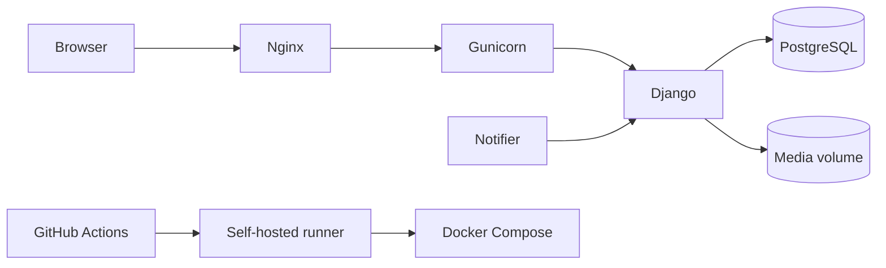

# Архитектура

## Общая схема



## Production request flow

```text
Browser
   ↓
Nginx
   ↓
Gunicorn
   ↓
Django
   ↓
PostgreSQL
```

Nginx:

- принимает HTTP-запросы;
- отдаёт static;
- проксирует приложение в Gunicorn.

Gunicorn запускает Django WSGI application.

PostgreSQL хранит прикладные данные.

Пользовательские изображения хранятся отдельно от БД в persistent Docker volume.

## Docker Compose services

### `db`

PostgreSQL 17.

Хранит данные в persistent volume `postgres_data`.

### `static-init`

Подготавливает права для volume со статическими файлами.

### `web`

Основное Django-приложение.

При старте:

1. ждёт PostgreSQL;
2. выполняет миграции;
3. выполняет `collectstatic`;
4. запускает Gunicorn.

### `notifier`

Периодически выполняет фоновые команды уведомлений.

Не является отдельным микросервисом: использует тот же Django-код и БД.

### `nginx`

Внешняя точка входа приложения.

По умолчанию приложение публикуется через `${APP_PORT:-8081}`.

## Django application

Основная бизнес-логика находится в приложении `tasks`.

Типичное разделение:

```text
tasks/
    models.py
    forms.py
    views.py                 # health check and home routing
    task_views.py            # task list/detail, search, filters
    task_action_views.py     # workflow actions, handovers, comments, images
    task_view_helpers.py     # shared task query, ownership and context helpers
    team_views.py            # dashboard, calendar, workload, activity feed
    department_views.py      # templates, notifications, absences, feature ideas
    reporting_views.py       # analytics, XLSX export, backup monitoring
    task_event_handlers.py   # task history and notification side effects
    urls.py
    services.py
    signals.py
    permissions.py
    templates/
    management/
    migrations/
```

### `models.py`

Сущности приложения:

- задачи;
- проектные метки задач;
- шаблоны;
- уведомления;
- комментарии;
- история;
- изображения;
- отсутствия.

### HTTP views

HTTP endpoint'ы разделены по назначению. `task_views.py` содержит списки задач,
карточку, поиск и сохранённые фильтры. `task_action_views.py` содержит переходы
статусов, передачи, комментарии и работу с изображениями. `team_views.py` содержит
дашборд, календарь, загрузку и ленту активности. `department_views.py` содержит
шаблоны, уведомления, отсутствия и идеи. `reporting_views.py` содержит аналитику,
выгрузки и мониторинг резервных копий. `views.py` оставлен для health check и
маршрутизации на домашнюю страницу.

Общие выборки и контекст задач находятся в `task_view_helpers.py`; права
проверяются на сервере в обработчиках и через `permissions.py`.


### Права на изменение задач

Проверки прав на изменение задачи централизованы в `permissions.py` (`can_manage_task`) и применяются непосредственно в HTTP-обработчиках. Отдельного слоя wrapper-view для Managers нет: это уменьшает дублирование HTTP-логики и риск расхождения проверок.

### `services.py`

Расчёт загрузки и другие операции, которые не должны находиться непосредственно в view.

### `signals.py` и обработчики событий

`signals.py` только связывает Django signals с обработчиками. Побочные действия
при изменении задач находятся в `task_event_handlers.py`:

- внутренние уведомления;
- фиксация событий.

## Принципы архитектуры

Проект намеренно остаётся монолитом.

Для отдела примерно из 15 пользователей микросервисы не дают практической пользы и значительно усложняют:

- deployment;
- backup;
- debugging;
- мониторинг;
- разработку.

Текущий Django monolith является предпочтительной архитектурой до появления реальной необходимости масштабирования.


## Изменения v0.7.0

### Автор и ответственный руководитель

В `Task` разделены две роли:

- `created_by` — неизменяемый автор для аудита;
- `responsible_manager` — текущий руководитель, имеющий право изменять, проверять и закрывать задачу.

При передаче ответственности меняется только `responsible_manager`; автор сохраняется.

### Персональные сохранённые фильтры

`SavedTaskFilter` хранит имя пользователя, название фильтра и белый список параметров task list в `JSONField`. URL применения строится сервером; пользователь не может получить фильтры другой учётной записи.

### Массовые операции

Массовое изменение работает через отдельный POST endpoint. Сервер повторно проверяет ownership каждой выбранной задачи и выполняет изменения в `transaction.atomic()` с обычным `Task.save()`, поэтому история и уведомления не обходятся через `QuerySet.update()`.

### Глобальный поиск

Поиск работает поверх того же queryset доступа, что и обычный список задач. Managers ищут по задачам отдела, Employees — только по назначенным им задачам.

### Шаблоны

Единственным источником HTML-шаблонов приложения является корневой каталог `templates/`. Старые дубли `tasks/templates/tasks/` удалены.
